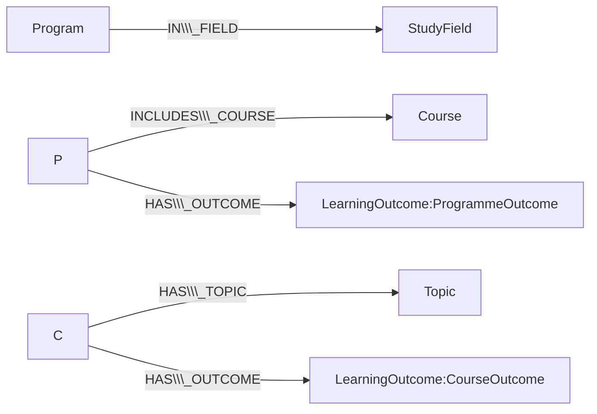

# Knowledge Graph of two RTU Master Programmes (Neo4j AuraDB)

**Author:** Yuxuan Xie 230AHC068  
**Course:** Knowledge Management Systems  
**Dataset:** https://github.com/ArithaRTU/KMS\_Dataset

This report shows how I explored the KMS dataset, designed a graph schema, loaded the data into Neo4j AuraDB and ran five queries on the resulting knowledge graph.

\---

## 1\. Dataset exploration

The dataset describes two Master programmes at Riga Technical University: **Business Informatics (DMB0)** and **Digital Humanities (HMD0)**. It has 5 node files and 4 edge files (CSV), plus two PDF programme descriptions.

|File|Rows|What it contains|
|-|-:|-|
|`nodes\\\_study\\\_programs.csv`|2|Programme title, level, language, aims, tasks, employment, ...|
|`nodes\\\_study\\\_fields.csv`|1|The study field both programmes belong to|
|`nodes\\\_study\\\_courses.csv`|75|Course title, ECTS, languages, abstract, aims, literature, prerequisites|
|`nodes\\\_course\\\_topics.csv`|640|Topics of each course, with contact / independent hours|
|`nodes\\\_learning\\\_outcomes.csv`|392|26 programme outcomes (PLO) and 366 course outcomes (CLO)|
|`program+study\\\_field.csv`|2|Programme → field|
|`program+course.csv`|89|Programme → course, with section and ECTS|
|`course+topic.csv`|640|Course → topic|
|`course+learning\\\_outcome.csv`|366|Course → course outcome|

**What I checked and found**

* No duplicate rows and no duplicate IDs in any file. Every ID has a clear prefix (`TOPIC\\\_`, `PLO\\\_`, `CLO\\\_`, ...).
* Referential integrity is perfect: every edge points to an existing node.
* Every one of the 75 courses belongs to at least one programme and has at least one learning outcome.
* **Six courses have no topics:** Digital Transformation, both Master Thesis courses, Study Design and Implementation, Computer-Assisted Text Analysis and Internship.
* `program+course.csv` has 89 rows but only 75 distinct courses. DMB0 has 29 courses and HMD0 has 50 distinct courses (60 rows). **Four courses are in both programmes**, and some HMD0 courses appear twice in different sections (e.g. DE0739 is both compulsory and field-specific). Because of this, the programme–course link must be able to repeat, so it carries the section as a property.
* The ECTS in the sections add up to more than 120 because the lists include courses of limited choice and free choice. Students do not take all of them.
* Course outcomes are owned by courses (`owner\\\_id` = course) and programme outcomes by programmes (`owner\\\_id` = DMB0 or HMD0). This is why programme outcomes need their own relationship.
* The topic hours columns are numeric. Some hours columns are 0 for extramural study.

\---

## 2\. Graph schema



**Nodes**

|Label|Key (unique)|Main properties|
|-|-|-|
|`Program`|`program\\\_id`|title, level\_and\_type, study\_mode, languages, credit\_points, aims, ...|
|`StudyField`|`study\\\_field\\\_id`|name|
|`Course`|`course\\\_id`|title, credit\_points, languages, abstract, aims, prerequisites, source\_url|
|`Topic`|`topic\\\_id`|title, ordinal, four hours columns, `total\\\_hours` (added by me)|
|`LearningOutcome` (+ `ProgrammeOutcome` or `CourseOutcome`)|`outcome\\\_id`|text, scope, ordinal|

**Relationships**

|Relationship|Count|Properties|
|-|-:|-|
|`(Program)-\\\[:IN\\\_FIELD]->(StudyField)`|2|–|
|`(Program)-\\\[:INCLUDES\\\_COURSE]->(Course)`|89|credit\_points, section\_code, section\_name, subsection\_name|
|`(Course)-\\\[:HAS\\\_TOPIC]->(Topic)`|640|–|
|`(Course)-\\\[:HAS\\\_OUTCOME]->(LearningOutcome)`|366|–|
|`(Program)-\\\[:HAS\\\_OUTCOME]->(LearningOutcome)`|26|–|

**Design decisions**

1. Each CSV node file became one label, and the IDs have uniqueness constraints.
2. `course\\\_id` was removed from `Topic` and `owner\\\_id` from `LearningOutcome`, because they are now relationships and would only duplicate information.
3. `INCLUDES\\\_COURSE` stores the section on the relationship because the same course can have a different role in different programmes or sections.
4. Outcomes have one common label (`LearningOutcome`) and a specific one, so queries can ask for all outcomes or only one kind.

Expected size after import: **1,110 nodes** (2 + 1 + 75 + 640 + 392) and **1,123 relationships** (2 + 89 + 640 + 366 + 26).

\---

## 3\. Importing into AuraDB

1. Create a free AuraDB instance at https://console.neo4j.io and save the credentials file (URI, username, password).
2. Clone the dataset next to this folder: `git clone https://github.com/ArithaRTU/KMS\\\_Dataset.git`
3. Install the libraries: `pip install neo4j pandas`
4. Set the credentials and run the script ([`import\\\_to\\\_auradb.py`](import_to_auradb.py)):

```bash
export NEO4J\\\_URI="neo4j+s://xxxxxxxx.databases.neo4j.io"
export NEO4J\\\_USER="neo4j"
export NEO4J\\\_PASSWORD="your-password"
python import\\\_to\\\_auradb.py --data ./KMS\\\_Dataset --reset
```

The script creates the constraints, loads nodes, loads relationships and prints the counts, which should match the numbers above.

Output of the import script (node and relationship counts match the expected numbers):

!\[Import output](screenshots/1\_import.png)

Graph schema in AuraDB (`CALL db.schema.visualization();`):

!\[Schema](screenshots/2\_schema.png)

\---

## 4\. Queries and results

All queries are in [`queries.cypher`](queries.cypher). Paste each one into the **Query** tab in the AuraDB console.

### Q1. Structure of each programme

Shows how the study courses are divided into sections in each programme.

```cypher
MATCH (p:Program)-\\\[r:INCLUDES\\\_COURSE]->(c:Course)
RETURN p.program\\\_id AS programme, r.section\\\_name AS section,
       count(DISTINCT c) AS courses, sum(r.credit\\\_points) AS ects
ORDER BY programme, section;
```

|programme|section|courses|ects|
|-|-|-:|-:|
|DMB0|Compulsory Study Courses|10|57.0|
|DMB0|Field-Specific Study Courses|8|42.0|
|DMB0|Final Examination|1|30.0|
|DMB0|Humanities and Social Sciences Study Courses|10|54.0|
|HMD0|Compulsory Study Courses|19|54.0|
|HMD0|Field-Specific Study Courses|36|126.0|

*Comment:* the 57 ECTS of compulsory courses for DMB0 matches the 57 ECTS written in the programme abstract, which is a good check that the import is correct.

!\[Q1 result](screenshots/3\_q1.png)

### Q2. Courses shared by both programmes

```cypher
MATCH (:Program {program\\\_id:'DMB0'})-\\\[:INCLUDES\\\_COURSE]->(c:Course)<-\\\[:INCLUDES\\\_COURSE]-(:Program {program\\\_id:'HMD0'})
RETURN DISTINCT c.course\\\_id AS course, c.title AS title, c.credit\\\_points AS ects
ORDER BY course;
```

|course|title|ects|
|-|-|-:|
|DE0645|Portfolio Management Technologies|6.0|
|DE0729|Communication and Presentation Skills|3.0|
|DE0739|Knowledge Management Systems|6.0|
|DE0751|e-Business Solutions|6.0|

*Comment:* only 4 of 75 courses are shared, so the two programmes are quite different. This is where the students of the two programmes meet.

!\[Q2 result](screenshots/4\_q2.png)

### Q3. Which courses teach about knowledge, ontologies or semantics?

```cypher
MATCH (c:Course)-\\\[:HAS\\\_TOPIC]->(t:Topic)
WHERE toLower(t.title) CONTAINS 'knowledge'
   OR toLower(t.title) CONTAINS 'ontolog'
   OR toLower(t.title) CONTAINS 'semantic'
RETURN c.course\\\_id AS course, c.title AS title, count(t) AS matching\\\_topics
ORDER BY matching\\\_topics DESC, course;
```

The query returns **13 courses** (20 matching topics). The first rows are:

|course|title|matching\_topics|
|-|-|-:|
|DE0739|Knowledge Management Systems|6|
|DE0809|Digital Textuality: Interdisciplinary Approach|2|
|DE1066|Digital Semantics and Pragmatics|2|
|DE0643|Pedagogy|1|
|DE0703|E-pedagogy and e-didactics|1|

*Comment:* this is a simple search over topics. It shows that the graph can answer questions that are hard to answer from the programme PDFs, because the topic text is linked to the course and the programme.

Result, part 1 (first rows):

!\[Q3 result, part 1](screenshots/5\_q3\_a.png)

Result, part 2 (remaining rows, 13 courses in total):

!\[Q3 result, part 2](screenshots/5\_q3\_b.png)

### Q4. The five most topic-heavy courses

```cypher
MATCH (c:Course)-\\\[:HAS\\\_TOPIC]->(t:Topic)
RETURN c.course\\\_id AS course, c.title AS title, c.credit\\\_points AS ects,
       count(t) AS topics, sum(t.total\\\_hours) AS total\\\_hours
ORDER BY topics DESC, total\\\_hours DESC
LIMIT 5;
```

|course|title|ects|topics|total\_hours|
|-|-|-:|-:|-:|
|DE0810|Introduction to Knowledge Society Technology|6.0|20|240|
|DE0809|Digital Textuality: Interdisciplinary Approach|6.0|19|160|
|DE0814|Audio and Video Data Processing|3.0|19|138|
|DE0827|Research Strategies and Writing for Academic Publishing|3.0|16|160|
|DE0717|Artificial Intelligence in Humanities|3.0|16|73|

*Comment:* the total hours use the `total\\\_hours` property computed during import. A 3 ECTS course such as DE0814 has almost as many topics as the biggest 6 ECTS courses.

!\[Q4 result](screenshots/6\_q4.png)

### Q5. Graph view of one course

```cypher
MATCH path = (p:Program)-\\\[:INCLUDES\\\_COURSE]->(c:Course {course\\\_id:'DE0739'})-\\\[:HAS\\\_TOPIC|HAS\\\_OUTCOME]->(x)
RETURN path;
```

Switch to the **Graph** view. The picture shows the course *Knowledge Management Systems* in the centre, its 6 topics and 6 learning outcomes around it, and both programmes (DMB0 and HMD0) connected to it. The course appears in HMD0 twice (compulsory and field-specific), so there are 3 programme–course links in total.

!\[Q5 graph](screenshots/7\_q5.png)

### Bonus: data-quality check

```cypher
MATCH (c:Course) WHERE NOT (c)-\\\[:HAS\\\_TOPIC]->()
RETURN c.course\\\_id AS course, c.title AS title ORDER BY course;
```

This returns the 6 courses without topics listed in Section 1.

\---

## 5\. Conclusions

* The dataset is clean and consistent, and it maps naturally to a graph: programmes, courses, topics and outcomes are connected by clear relationships.
* The only modelling difficulty was that a course can be linked to the same programme more than once, which I solved by storing the section on the relationship.
* The graph makes it easy to compare programmes (Q1, Q2), search the content (Q3), analyse workload (Q4) and explore the neighbourhood of one course (Q5).
* Possible next step: link similar topics or outcomes between courses (for example with text embeddings) to find overlaps between courses.

\---

## Files in this repository

|File|Purpose|
|-|-|
|`README.md`|This report|
|`import\\\_to\\\_auradb.py`|Loads the CSV files into AuraDB|
|`queries.cypher`|The queries used in the report|
|`screenshots/`|Screenshots of the AuraDB results|


